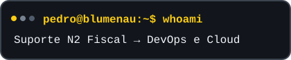

# Pedro Henrique Evers

Atuo no **Suporte N2 Fiscal da Linx (TOTVS)**, onde investigo falhas de emissão e integração de documentos fiscais. Analiso logs, faço consultas em PostgreSQL e examino XMLs de NF-e e NFC-e para identificar a origem dos problemas. Também automatizo tarefas repetitivas do suporte.

Curso **Análise e Desenvolvimento de Sistemas na Uniasselvi** e estou em transição para **DevOps e Cloud**. Nos meus laboratórios, uso Terraform para provisionar infraestrutura na AWS e pratico deploy de aplicações com Docker, Kubernetes e GitLab CI/CD.

## Projetos

- [SimulaCloud](https://github.com/PHEvers/SimulaCloud) — simulados para AWS Cloud Practitioner.
- [ChatProbe](https://github.com/PHEvers/ChatProbe) — projeto de automação de testes de chatbots pela web.

## Labs de DevOps

- **Terraform e Ansible** — dois labs com EC2, um com balanceador de carga e outro com Nginx configurado via Ansible.
- **Kubernetes na AWS** — infraestrutura de um cluster em EC2 com Terraform.
- **GitLab CI/CD** — build Docker e deploy de uma API .NET em staging e produção com kind.

[+Dev2Blu 2026](https://github.com/PHEvers/-Dev2Blu-2026) · [LinkedIn](https://www.linkedin.com/in/pedro-henrique-evers-903a3ab3/) · [E-mail](mailto:pedroevers@gmail.com)
